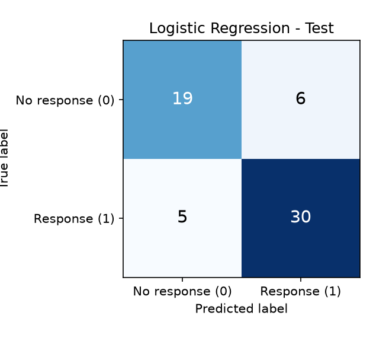
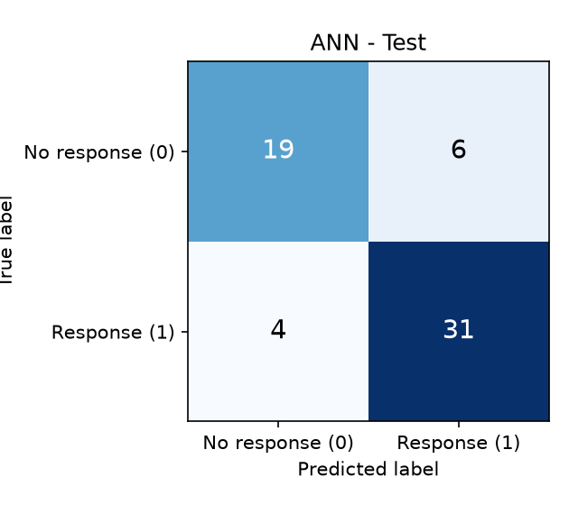
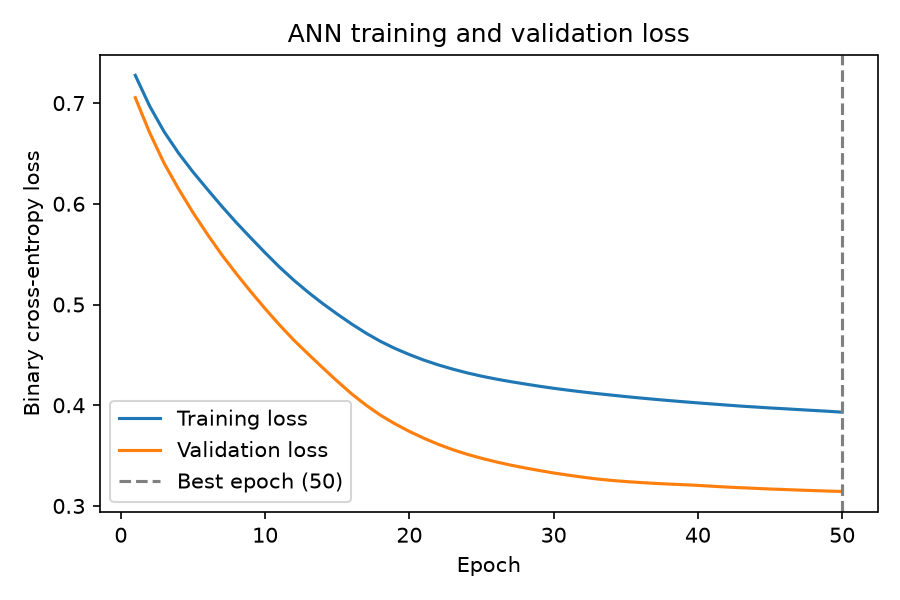
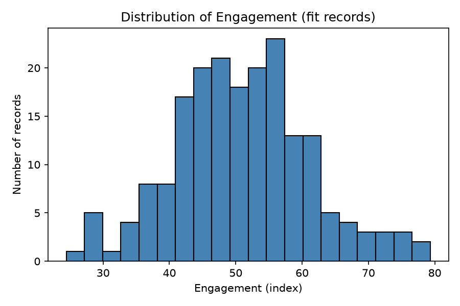
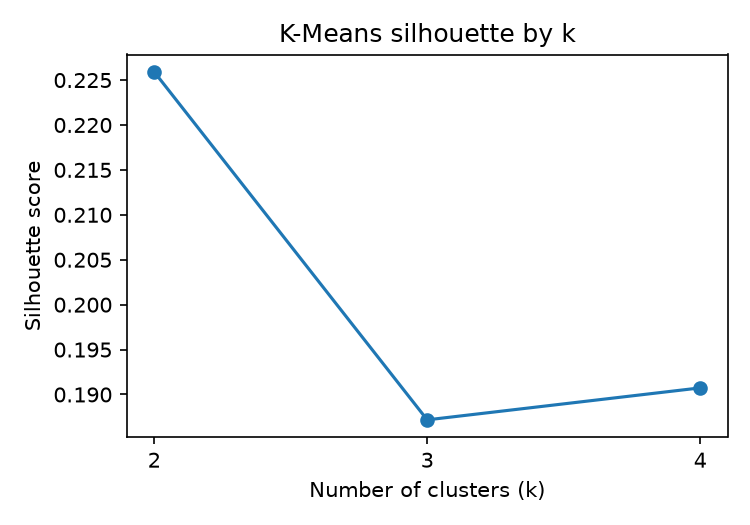

<div align="center">

# 🎯 Campaign Response Prediction & Audience Segmentation

### An end-to-end Data Science & AI/ML project — from raw data to a trained neural network


**Will a customer respond to a marketing campaign? And who are our customer segments?** 🤔
This project answers both using statistics, machine learning, clustering and deep learning.

[📓 Notebook](notebooks/exam.ipynb) • [🎬 Video](#-video-walkthrough) • [📊 Results](#-results) • [🚀 Quick Start](#-quick-start) • [📁 Structure](#-project-structure)

</div>

---

## 🎬 Video Walkthrough

<div align="center">


▶️ **[Click here to watch the full project explanation](https://drive.google.com/file/d/1iJRABWNzPKJn2yp3UHd6aVEg6M1Oe0Yc/view?usp=sharing)**

</div>

---

## 📌 Table of Contents

- [🎬 Video Walkthrough](#-video-walkthrough)
- [✨ Highlights](#-highlights)
- [🗂️ Dataset](#️-dataset)
- [🧩 Project Modules](#-project-modules)
- [📊 Results](#-results)
- [🔒 Leakage Prevention](#-leakage-prevention)
- [🚀 Quick Start](#-quick-start)
- [📁 Project Structure](#-project-structure)
- [🛠️ Tech Stack](#️-tech-stack)
- [💡 Key Takeaways](#-key-takeaways)
- [👤 Author](#-author)

---

## ✨ Highlights

| | |
|---|---|
| 🧹 **Clean pipeline** | Duplicates removed *before* splitting, all transformers fitted on training data only |
| 📐 **Math & Stats** | Descriptive stats, Welch t-test, 95% confidence interval, covariance & eigenvalues |
| 🤖 **Supervised ML** | Majority baseline vs. Logistic Regression |
| 🧬 **Unsupervised ML** | K-Means with silhouette-based selection of *k* and named customer segments |
| 🧠 **Deep Learning** | Keras ANN (16 → 8 → 1) with early stopping |
| ♻️ **Reproducible** | Fixed seed (`42`), saved models, saved predictions, reconciliation checks |

---

## 🗂️ Dataset

Synthetic customer data generated by [`src/generate_data.py`](src/generate_data.py) (seed `404`).

| Column | Description |
|---|---|
| `record_id` 🔑 | Unique identifier (never used as a feature) |
| `visits` | Number of visits (index) |
| `recency` | Time since last activity (higher = longer ago) |
| `engagement` | Engagement score (index) |
| `spend` | Spending (index) |
| `group` | Customer group `G1` / `G2` |
| `response` 🎯 | **Target** — `1` = responded, `0` = no response |

> 📏 **300 unique records** (305 raw rows incl. 5 exact duplicates), with intentional missing values in `visits` and `recency`.

**Partitions** (stratified on the target, fixed IDs saved to `outputs/splits.csv`):

```
300 records ──► 240 train ──► 192 fit  🏋️
           │              └─► 48 validation 🔍
           └─► 60 test 🧪
```

---

## 🧩 Project Modules

<details open>
<summary><b>1️⃣ Maths & Advanced Stats 📐</b></summary>

- Descriptive statistics for `engagement` (mean, median, std)
- **Welch two-sample t-test** between G1 and G2 → fail to reject H₀ (p ≈ 0.47)
- **95% confidence interval** for overall mean engagement ≈ [49.5, 52.5]
- Manual **covariance matrix** + eigen-decomposition of (`engagement`, `visits`) — the first principal direction explains only ≈ 52% of variance, so the two variables carry mostly separate information

</details>

<details>
<summary><b>2️⃣ Preprocessing & Feature Engineering 🧹</b></summary>

- Audit: duplicates, missing values, target balance
- Median imputation + `StandardScaler` + `OneHotEncoder` (all fitted on **fit data only**)
- Engineered feature: `engagement / (recency + 1)`
- Fitted objects saved to `models/preprocessing.joblib`

</details>

<details>
<summary><b>3️⃣ Supervised Learning 🤖</b></summary>

- Majority-class baseline vs. **Logistic Regression**
- Evaluation on the untouched 60-record test set (threshold 0.5)
- Business interpretation of false positives vs. false negatives

</details>

<details>
<summary><b>4️⃣ Unsupervised Learning 🧬</b></summary>

- K-Means for k ∈ {2, 3, 4}, chosen by **silhouette score**
- Two named segments:
  - 🔥 **Active engaged customers** → loyalty benefits / early access
  - 🌙 **Cooling / lapsing customers** → re-activation campaign

</details>

<details>
<summary><b>5️⃣ Deep Learning — ANN 🧠</b></summary>

- Architecture: `Dense(16, relu) → Dense(8, relu) → Dense(1, sigmoid)`
- Loss: **binary cross-entropy**, optimizer: **Adam (lr = 0.001)**
- Early stopping on validation loss (patience 5), batch size 16, up to 50 epochs

</details>

---

## 📊 Results

### 🏆 Model Comparison (60 held-out test records)

| Model | Accuracy | Precision | Recall | F1 |
|:---|:---:|:---:|:---:|:---:|
| 🪨 Baseline (majority) | 0.583 | 0.583 | 1.000 | 0.737 |
| 📈 Logistic Regression | 0.817 | 0.833 | 0.857 | 0.845 |
| 🧠 ANN | **0.833** | **0.838** | **0.886** | **0.861** |

> ⚖️ The ANN beats logistic regression by about **one record** — within the noise of a 60-record test set. Logistic regression is preferred for its simplicity and interpretability.

### 🔲 Confusion Matrices

<div align="center">

| 📈 Logistic Regression | 🧠 ANN |
|:---:|:---:|
|  |  |

</div>

### 📉 ANN Training Curve

<div align="center">
  
</div>

> Validation loss was still falling at epoch 50, so early stopping never triggered — a sign of **mild underfitting / not yet converged**, not overfitting.

### 🧬 Clustering & Distribution

<div align="center">

| 📊 Engagement Distribution | 🎯 K-Means Silhouette |
|:---:|:---:|
|  |  |

</div>

> **k = 2** had the best silhouette (≈ 0.23). It is low, so segments overlap — treat them as a rough grouping.

---

## 🔒 Leakage Prevention

| ❌ Excluded / ✅ Handled | Why |
|---|---|
| `response` (target) | The model would "see the answer" |
| `record_id` | Meaningless ID — can be memorised, won't generalise |
| Test-set statistics | Imputer, scaler & encoder are fitted on the **192 fit rows only** |
| Duplicates | Removed **before** splitting so copies can't land in both train and test |

---

## 🚀 Quick Start

**1️⃣ Clone the repository**

```bash
git clone https://github.com/<your-username>/<your-repo-name>.git
cd <your-repo-name>
```

**2️⃣ Create a virtual environment**

```bash
python -m venv .venv

# Windows
.venv\Scripts\activate

# macOS / Linux
source .venv/bin/activate
```

**3️⃣ Install dependencies**

```bash
pip install -r requirements.txt
```

**4️⃣ Run the notebook** 🎉

```bash
jupyter notebook notebooks/exam.ipynb
```

> 💡 The raw data is generated automatically on first run via `src/generate_data.py` if it doesn't exist.

**Or run everything headlessly:**

```bash
jupyter nbconvert --to notebook --execute notebooks/exam.ipynb --output exam_executed.ipynb
```

**Load the saved ANN for inference:**

```python
import joblib
from tensorflow import keras

model = keras.models.load_model("models/ann_model.keras")
prep  = joblib.load("models/preprocessing.joblib")   # imputer, encoder, scaler
```

---

## 📁 Project Structure

```
📦 repo
├── 📂 data
│   └── 📂 raw
│       └── 📄 set_d.csv               # generated dataset
├── 📂 models
│   ├── 🧠 ann_model.keras             # trained ANN
│   ├── ⚖️ ann.weights.h5              # ANN weights
│   └── 🔧 preprocessing.joblib        # fitted imputer / encoder / scaler
├── 📂 notebooks
│   └── 📓 exam.ipynb                  # full analysis (all 5 modules)
├── 📂 outputs
│   ├── 📂 figures                     # all plots
│   ├── 📄 ann_history.csv
│   ├── 📄 cluster_profiles.csv
│   ├── 📄 confusion_matrix_{ann,logistic}.csv
│   ├── 📄 kmeans_scores.csv
│   ├── 📄 metrics_comparison.csv
│   ├── 📄 predictions_{ann,logistic}.csv
│   ├── 📄 splits.csv
│   ├── 🗒️ linear_algebra.json
│   ├── 🗒️ preprocessing_audit.json
│   ├── 🗒️ stats_summary.json
│   └── 🗒️ versions.json
├── 📂 src
│   └── 🐍 generate_data.py            # data generator
├── 📄 requirements.txt
└── 📄 .gitignore
```

---

## 🛠️ Tech Stack

| Category | Tools |
|---|---|
| 🐍 Language | Python |
| 🔢 Numerical | NumPy, SciPy |
| 🐼 Data | Pandas |
| 🤖 ML | scikit-learn |
| 🧠 Deep Learning | TensorFlow / Keras |
| 📊 Visualisation | Matplotlib |
| 📓 Environment | Jupyter, nbconvert, ipykernel |

---

## 💡 Key Takeaways

1. 📉 **No significant engagement difference** between G1 and G2 (Welch p ≈ 0.47).
2. 🚀 **Both models clearly beat the baseline** — accuracy rises from 0.58 to ~0.82–0.83.
3. 🎯 **Logistic regression is the practical choice**: nearly identical performance, instant training, and interpretable coefficients (engagement ↑, recency ↓ drive response).
4. 🧬 **Two customer segments** emerge — *active engaged* and *cooling/lapsing* — each with a tailored marketing action.
5. ⚠️ **Small test set (60 records)** — one record shifts accuracy by ~1.7 pp, so results are indicative, not deployment-ready.

---

## 👤 Author

**Krisha Anghan**

[](https://github.com/krisha12345819)
[](https://www.linkedin.com/in/krisha-anghan-bb1179382/)

<div align="center">

⭐ **If you found this project useful, please give it a star!** ⭐

Made with ❤️ and ☕ using Python

</div>
